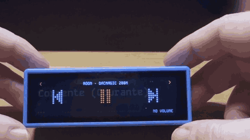
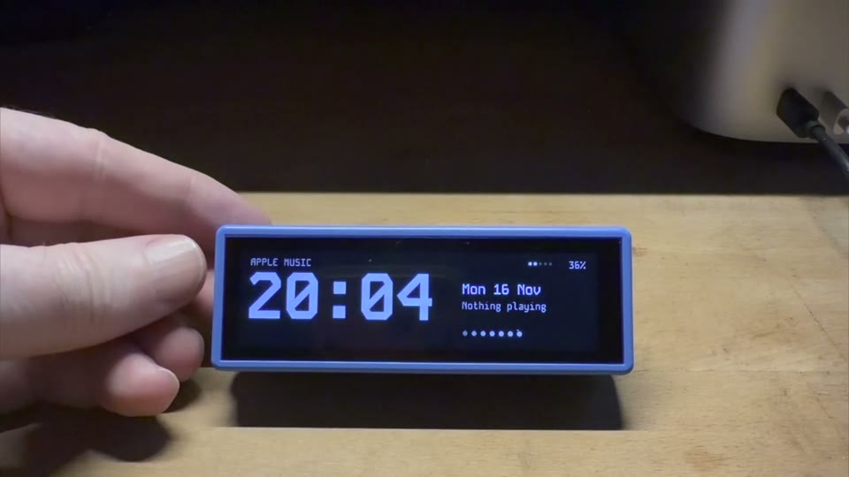
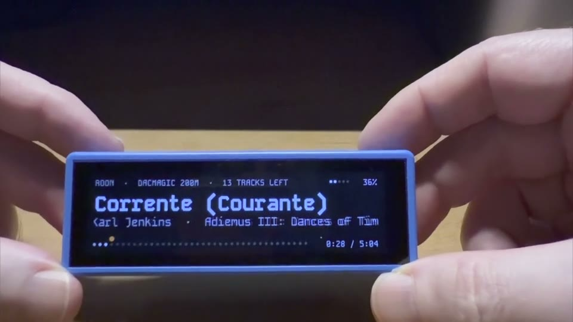
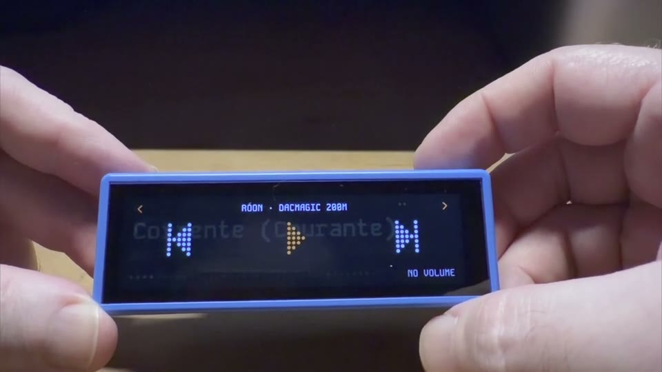
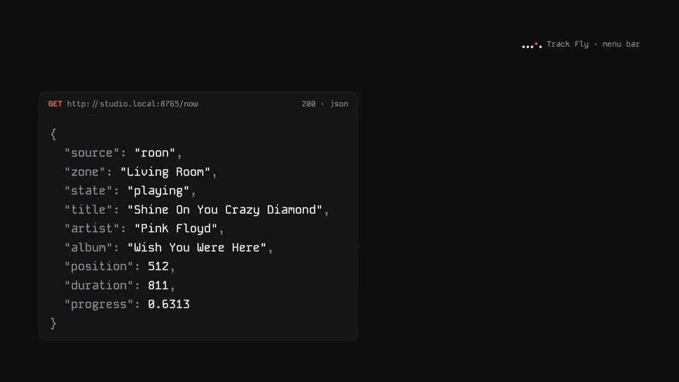

# Track Fly display for the Waveshare ESP32-S3-Touch-LCD-3.49



Firmware that turns the [Waveshare ESP32-S3-Touch-LCD-3.49](https://www.waveshare.com/esp32-s3-touch-lcd-3.49.htm) (a 640×172 touch bar with a battery) into a now-playing display for your Mac.

It reads the feed of **[Track Fly](https://trackfly.stream)**, a free macOS menu bar app that turns what is playing in Apple Music, Spotify, Roon and Plex into one JSON feed on your local network. You need Track Fly running on a Mac on the same network.

**Website and downloads: [trackfly.stream](https://trackfly.stream)** · Ready-made firmware: [trackfly.stream/firmware](https://trackfly.stream/firmware/)

| Nothing playing | Playing | Controls |
|---|---|---|
|  |  |  |

## What it does

- **Now playing:** title, artist and album, with the source, Roon zone or player, place in the album or queue, and progress.
- **One tap for controls:** previous, play/pause, next, and a row of dots that becomes the volume.
- **Follows a room:** pick a Roon zone or a player on the screen or on its web page, or let it show whatever plays.
- **A clock when nothing plays,** a night mode, and it turns the picture when you flip it over (motion sensor).
- **Sleeps on battery:** after a few idle minutes it goes dark and checks every two minutes whether music is back.
- **Finds the Mac by itself:** if the Mac's address changes, it looks for Track Fly on the network (`_trackfly._tcp`).
- **Updates in one click:** Track Fly fetches new firmware from trackfly.stream and offers it to every display it sees. You can also upload a `.bin` on the display's own web page.
- **Set up from your phone** with a QR code. No app, no cloud, no account.

## Install

The easiest way is a ready-made image from [trackfly.stream/firmware](https://trackfly.stream/firmware/):

- **First install over USB:** write `trackfly_ekran-<version>-full-usb.bin` at offset `0x0`, for example with
  `esptool.py --chip esp32s3 write_flash 0x0 trackfly_ekran-<version>-full-usb.bin`
- **Later versions:** Track Fly offers them by itself, or upload `trackfly_ekran-<version>.bin` on the display's page (`http://track-fly-xxxx.local`, Firmware).

Or build it yourself (below).

## First setup

1. Power on. The screen shows a QR code and the network `TRACK-FLY-XXXX` (password `trackfly`; XXXX is the end of the MAC address).
2. Scan the QR code with your phone, or join that network yourself. The setup page opens (otherwise go to `192.168.4.1`).
3. Pick your home network, type its password, check the Track Fly address, and press Save.
4. After it connects, its settings page is at `http://track-fly-xxxx.local` (same 4 characters).

On battery: after fitting the battery, connect USB once to wake the board; after that it runs on the battery. Long-press PWR to turn it on.

## Controls

| | short press | long press |
|---|---|---|
| BOOT | brightness (25/50/75/100%); two quick presses: play/pause | 3 s: WiFi setup mode |
| PWR | screen on/off | 2 s: power off (on battery) |

Touch: one tap opens the control layer (it ignores touches for its first 0.5 s and closes 6 s after the last touch). In it, the top corners `<` `>` switch what to follow (Auto, Roon zones, sources); the left, middle and right thirds are previous, play/pause and next; drag along the bottom row of dots for volume. Hold 2 s on the normal screen for device info.

## Build

The sketch is in [`trackfly_ekran/`](trackfly_ekran). With [arduino-cli](https://arduino.github.io/arduino-cli/) and the ESP32 core installed:

```bash
cd trackfly_ekran
./build_firmware.sh          # firmware/trackfly_ekran-<ver>.bin (web update) and -full-usb.bin
./build_firmware.sh upload   # also flashes over USB
```

The script fetches LVGL 9.5.0 and Arduino_GFX 1.6.4 into `~/Library/Caches/trackfly_ekran-libs` and builds for ESP32-S3 with 16 MB flash, OPI PSRAM and the `app3M_fat9M_16MB` partition scheme (see `FQBN` in the script). It is written for macOS; on Linux, change the cache and esptool paths.

Waveshare sells two revisions of this board, and their pin maps differ. The pins are in `user_config.h`; check them against your board's schematic.

## How it talks to Track Fly

The display polls `http://<mac>:8765/now` and gets JSON like this:

```json
{ "state": "playing", "source": "roon", "zone": "Living Room",
  "title": "Wish You Were Here", "artist": "Pink Floyd", "album": "Wish You Were Here",
  "position": 61.2, "duration": 334.7, "progress": 0.18 }
```

Controls go to `/control?action=playpause|next|prev|volume&value=40`. The full field list is on [trackfly.stream](https://trackfly.stream/#fields). The same feed works for Home Assistant, an LED matrix, e-ink, a stream overlay or a script.



## Credits

- Board support (`i2c_bsp.*`, `user_config.h`) is based on Waveshare's examples for this board.
- [LVGL](https://lvgl.io) and [Arduino_GFX](https://github.com/moononournation/Arduino_GFX) for drawing, [ArduinoJson](https://arduinojson.org) (MIT, included as a single header) for the feed.
- Fonts: [Kode Mono](https://github.com/isaozler/kode-mono) (SIL Open Font License), converted with lv_font_conv.

Not affiliated with Waveshare, Apple, Spotify, Roon Labs or Plex.
